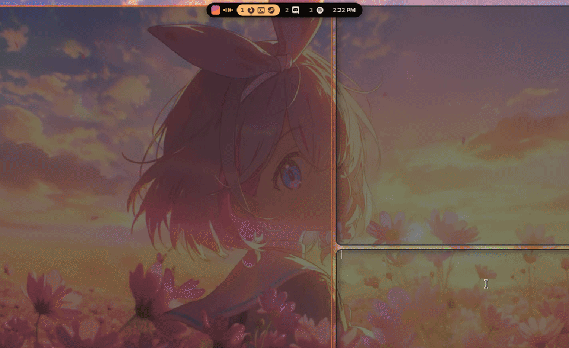

# Rust Dynamic Island for Mango

A minimal, modular, all-in-one desktop tool for [MangoWC](https://mangowm.github.io),
written in Rust. One pill replaces your bar, app launcher, notification daemon and
power menu, and adds clipboard search, screenshots, Wi-Fi and Bluetooth. Use all of it,
or only the parts you want.

**[Project page](https://nurexa.github.io/Rust-Dynamic-Island-for-Mango/)** ·
[Modding guide](MODDING.md)



## What's in it

| Part | Replaces | How you reach it |
|---|---|---|
| Bar | Waybar | Hover the pill |
| App search | rofi `drun` | `island open apps` |
| Run prompt | rofi `run` | `island open run` |
| Window switcher | rofi `window` | `island open windows` |
| Notifications | dunst, mako | Appear in the pill, with history in the panel |
| Clipboard | rofi and cliphist scripts | `island open clipboard` |
| Screenshots | grim and slurp scripts | `island open screenshot`, `island shot region` |
| Wi-Fi | rofi-wifi scripts | `island open wifi` |
| Bluetooth | blueman, rofi-bluetooth | `island open bluetooth` |
| Wallpaper picker | rofi thumbnail scripts | `island open wallpaper` |
| Power menu | wlogout | `island open power` |
| Script menus | `rofi -dmenu` | `island dmenu` |
| Calculator and units | qalculate, rofi-calc | Type `84/2` or `10 km to mi` in app search |
| File search | fsearch, rofi file scripts | `island open files` |
| Web search | browser start pages | The last row of app search |
| Pomodoro | timer apps | The panel, or `island timer` |
| Night light | wlsunset, gammastep | The panel, or `island nightlight` |
| Per-app volume | pavucontrol | Click the output's name in the panel |
| Monitor brightness | ddcutil scripts | A slider per monitor in the panel |
| Battery | Waybar's battery module | The pill, on laptops |
| Mic and camera dots | | The pill, while an app uses them |
| Claude Code status | | The pill, with permission cards |

**Every part is optional.** Leave it out of a list in the config, or leave it out of the
binary with a Cargo feature. A tool costs nothing until you open it: its list is built
on demand and dropped when it closes.

The island doesn't replace your lock screen, idle daemon or polkit agent. Those guard
your session, and they should stay small, separate programs.

## Benchmarks

Island, Waybar 0.15.0 and [mangobar](https://github.com/mangowm/mangobar) 0.2.2 (stock config),
in one private headless Mango with the same windows and apps. Each number is the median of
5 runs, with the order rotated so none gets the warm cache, and child processes count.
Lower is better, and the best is bold.

| | Waybar | mangobar | Island |
|---|---|---|---|
| Real memory (PSS) | 34.2 MB | 18.6 MB | **12.5 MB** |
| Resident memory (RSS) | 70.8 MB | 40.6 MB | **39.7 MB** |
| CPU per workspace switch | 29 ms | **0.5 ms** | **0.5 ms** |
| Bar startup | 102 ms | 50 ms | **32 ms** |
| Idle wakeups per second | **3.1** | 12.0 | 9.7 |
| Idle CPU | 0–0.03% | 0–0.07% | 0% |
| Binary size | 2.5 MB | **0.3 MB** | 3.4 MB |

The island and mangobar tie on drawing a workspace change. That cost is counted in 10 ms
clock ticks over 40 switches, so 0.25 ms is the resolution. mangobar is a 0.3 MB C program
that only draws a bar, dynamically linked to more libraries (65 against the island's 40);
the island is also the launcher, notifications, clipboard and screenshots, and still uses
the least memory. Idle wakeups swing with audio-server events between sessions (the island
read 4.0 in an earlier run), so treat that row as a range. Idle CPU is a tie between all
three. Waybar's switch cost includes the helper commands its custom workspace modules run,
not the separate script that feeds them. Opening the
palette adds about 4 MB while it's open, and the first Waybar run was a cold start
(201 ms), which is why the median matters. A busy desktop moves these numbers, so rerun it
on yours.

The previous run, against Waybar plus dunst and rofi (both since uninstalled on the test
machine), had 47 MB for the Waybar and dunst stack against 13.6 MB, and 41 ms for rofi
against 8 ms for the island's launcher.

Run `bench/run.py` to reproduce this; raw results are in `bench/results.json`.

## Install

From a terminal inside your Mango session:

```sh
git clone https://github.com/nurexa/Rust-Dynamic-Island-for-Mango
cd Rust-Dynamic-Island-for-Mango
./install.sh             # everything
./install.sh --manual    # the same, but asks about each part and each key first
./install.sh --bar-only  # only replace the bar; launchers, dunst and your binds stay
./install.sh --undo      # put it all back
```

Or from a package, then run its installer the same way:

```sh
paru -S rust-dynamic-island-git            # Arch (AUR); rust-dynamic-island for releases
/usr/share/island/install.sh

nix profile install github:nurexa/Rust-Dynamic-Island   # Nix
~/.nix-profile/share/island/install.sh
```

It prints each step as it goes and sends a notification when it's done.

The installer keeps your key bindings on the same keys and only changes what they run,
so a key that opened rofi, wofi, fuzzel, tofi, anyrun or walker now opens the island.
Each original line stays in your config as a comment, and `--undo` restores the file
exactly. The island's own keys and window rule go in `mango/island.conf`, which your
config sources from one marked block. Both `config.conf` and `config.toml` work, and so
does a config that's a symlink into your dotfiles; `MANGO_CONFIG=/path` points it anywhere
else.

If you already use one of the island's keys (Mango's own default config takes `SUPER+i`),
yours wins: the installer leaves that island key out and tells you which line has it.
`--manual` asks for another key instead. Waybar, dunst, mako or swaync started from
`exec_once` stop starting with the session, and `--undo` starts them again. It also masks
dunst's service, because D-Bus would otherwise restart it on the next notification.

A plain install keeps every extra this machine can run (the table above) and adds Claude
Code's hooks if it's installed. `--manual` asks about each extra, a night light schedule
and the web search engine, and writes only what you chose to `~/.config/island/config.toml`.
Run `island doctor` afterwards to see what works here.

It checks the result with Mango's own parser (`mango -p`). Warnings your config already
had don't block it, and if anything new goes wrong, or the island doesn't come up, it
rolls back on its own. Nothing is uninstalled, so your old tools stay available.

Builds need Rust, `cairo`, `pango` and `libxkbcommon`. At runtime the island uses
`pactl`, `wpctl`, `playerctl` (with `playerctld`), `curl`, `adwaita-icon-theme` and any
Nerd Font. Each tool lists what it needs in [MODDING.md](MODDING.md), and one whose
programs are missing simply doesn't appear.

## Using it

| Do this | To get this |
|---|---|
| Hover the pill | Open the panel; move away to close it |
| `Super+Space`, or any bind you've moved over | Open the palette |
| Click the pill background, or `Super+I` | Keep the panel open (pin) |
| Drag the pill | Move it anywhere on that monitor |
| Double-click the background, or `Super+Alt+I` | Send it home |
| Middle-click the background, or `Super+Shift+I` | Tuck it into a thin sliver |
| Scroll on the pill | Move through occupied workspaces |

In the palette, type to search, use the arrows or `Ctrl+N`/`Ctrl+P` to move (every palette key is rebindable under `[keys]` in the config), and press
`Enter` to choose. `Tab` moves between tools, and `Esc` closes it. Reboot, shut down and
log out ask for a second `Enter`.

The island always floats over your windows and never moves them. It stays under
fullscreen windows, apart from the palette and critical notifications. Keyboard focus
is taken only while the palette is open, and goes straight back afterwards.

Notifications appear in the pill and leave on their own. Hover one to hold it, click it
to open or dismiss, and right-click to dismiss. Critical ones stay until you deal with
them. `island dnd` turns on do not disturb, which keeps notifications in the panel's
history without showing them.

Several from one app within a few seconds share one card that shows the newest and a
`+N` count. The history groups them by app: click an app's header to see all of them,
or its `×` to clear them. Apps that take inline replies (chat apps on KDE and GNOME do)
get a Reply button: type into the card and press `Enter` to send, or `Esc` to cancel.

App search answers sums and conversions (`2^10/3`, `sqrt(2)*pi`, `72 f in c`,
`3.5 GiB to MB`) in its top row, where `Enter` copies the answer, and ends with a web
search for what you typed (`web_search` picks the engine). `island open files` searches
files as you type, with plocate's index or fd.

The pomodoro runs from its panel row or `island timer` (`start`, `toggle`, `stop`,
`skip`, or minutes for a plain countdown). While it runs the pill shows the minutes left,
and a note says when each phase ends; lengths are under `[pomodoro]`.

The night light warms and dims the screen itself, with no wlsunset or gammastep: click
its icon in the panel, drag its slider for warmth, run `island nightlight`, or give it a
`schedule` under `[nightlight]`.

Click the output's name in the panel for every output and microphone to switch to, and a
slider and mute for each app that's playing. The pill shows an orange dot while an app
records a microphone and a green one while an app has the camera; hover to see which.
On a laptop the pill shows the battery, plugging in flashes "Charging", and notes warn at
20% and 10%. With ddcutil, each desktop monitor gets its own brightness slider.

With Claude Code installed, the pill shows what each session is doing: working, needs
you, or done. A permission prompt in a terminal you're not looking at becomes a card
with Allow, Always allow and Deny, and a session that finishes while you're elsewhere
leaves a note that jumps back to its terminal. `island claude-setup` adds the hooks
(the installer does this for you) and `island claude-setup --undo` takes them out.

`island doctor` checks what works on this machine and says how to fix what doesn't.

Panel controls:

| Control | Left | Right | Middle | Scroll |
|---|---|---|---|---|
| Workspace chip | Switch to it | Send the focused window there | | |
| App icon | Focus that window | Send the focused window to that workspace | | |
| Volume slider | Set volume, or drag | Open the mixer | | ±5% |
| Speaker icon | Mute | Open the mixer | | |
| Network | Open the Wi-Fi tool | Run `wifi_alt` | | |
| Bluetooth | Open the Bluetooth tool | | | |
| Bluetooth switch | Turn the adapter on or off | | | |
| Wallpaper button | Open the picker | Run `wallpaper_next` | Run `wallpaper_toggle` | |
| Tray icon | Activate | App's menu | Secondary activate | |
| Album art on the pill | Play or pause | Next | Previous | |

## Wallpapers

`wall/wall` is a small animated-wallpaper engine (needs `gslapper`, `ffmpeg`, `awww`) that
the installer puts in `~/.local/bin`. Set `wallpaper_opt = "wall opt"` and the wallpaper picker gains **Settings ›**: fit (fill,
or the whole picture with black bars for non-16:9 videos), speed, frame rate and quality,
for every wallpaper or just the one showing.

Videos play from a cached copy encoded once at your monitor's exact size and frame rate, so
nothing is rescaled or retimed while playing. Changing a setting re-encodes once (with a
crossfade when it's ready) and is remembered. Open the picker with `island open wallpaper`; Settings expands into Fit, Speed, FPS,
Quality and Apply to, and Esc steps back out. `wall opt` does the same from a terminal.
They stay out of the main panel by default; add `"wallpaper"` to `panel` if you want them there.

## Make it yours

Everything is in `~/.config/island/config.toml`, and `island reload` applies changes
without a restart. [`examples/config.toml`](examples/config.toml) lists every option.

```toml
tools = ["apps", "clipboard", "projects"]   # the palette's tabs
notifications = false                       # keep your own daemon
icon_style = "glyph"                        # two-tone glyphs, or "color" for app icons

[[tool]]                                    # a tool made of two shell commands
name = "projects"
list = "ls ~/Projects"
run = "kitty -d ~/Projects/{}"

[[custom]]                                  # a pill or panel module from one command
name = "weather"
exec = "curl -s 'wttr.in/?format=%t'"
interval = 600
```

For a smaller binary, build only what you need:

```sh
cargo build --release --no-default-features --features "apps,clipboard,notifications"
```

Scripts written for rofi work by swapping the command:

```sh
choice=$(printf 'Small\nLarge\n' | island dmenu -p "Size")
```

Modules and tools are one file each, and compositor support sits behind a six-method
trait. [MODDING.md](MODDING.md) covers all of it, with worked examples.

## How it works

| Path | Job |
|---|---|
| `src/modules/` | One file per pill and panel module, and the list that orders them |
| `src/tools/` | One file per palette tool, and the list that registers them |
| `src/wm/` | Compositor backends, and the trait they implement |
| `src/palette.rs` | Search, ranking and keys for every tool |
| `src/notify.rs` | The notification queue and history |
| `src/island.rs` | One island per output: states, springs, frames, input |
| `src/pen.rs` | The drawing kit modules share, and the glyph table |
| `src/bus.rs` | D-Bus: media, tray and the notification service |
| `src/net.rs` `src/audio.rs` `src/sys.rs` | Network, audio devices and apps, hardware stats |
| `src/bluetooth.rs` `src/power.rs` `src/ddc.rs` | BlueZ, UPower and ddcutil, each by event or on demand |
| `src/nightlight.rs` `src/privacy.rs` `src/timer.rs` | Gamma ramps, camera watch, pomodoro |
| `src/claude.rs` `src/doctor.rs` | Claude Code hooks; `island doctor` |
| `src/theme.rs` `src/icons.rs` `src/settings.rs` | Palette, icons, config, saved state |

Why it doesn't use the obvious approach in a few places:

- **The surface never resizes.** A layer surface resize takes a round trip per frame,
  so one fixed transparent surface holds the morph, and the input region follows the
  visible shape so clicks pass through the rest.
- **Rendering is CPU only.** Cairo draws into shared memory with no GL context. Content
  renders once into cached surfaces, so animation frames just composite those.
- **Nothing runs while idle.** There are no animation loops, and Mango, audio, media,
  network and theme all arrive as events. Tools load on demand, and stats are read only
  while a panel is open.
- **Drags use relative pointer motion.** Surface coordinates race the island's own
  position updates and jitter.
- **NVML lives in a child process.** It uses tens of MB, and each init and shutdown
  leaks a file descriptor inside the driver library. The `--gpu-sampler` child runs only
  while a panel is open.
- **Untrusted text stays text.** Notification markup is flattened instead of rendered,
  and clipboard contents and filenames never reach a shell.

## Tests

```sh
cargo test                 # unit tests
tests/headless/all.sh      # end-to-end
```

The end-to-end suite runs a private headless Mango and a private session bus, drives a
virtual pointer and keyboard, and checks results through Mango's IPC and screenshots.
Audio, `systemctl` and `nmcli` are shimmed and the system bus is a private one with a fake
BlueZ, so it can't change your volume, network or Bluetooth, or reboot your machine.

Never start a test Mango with `DBUS_SESSION_BUS_ADDRESS` set: on exit it stops
`graphical-session.target`, which takes the live desktop down. `start.sh` unsets it.

## Limits

- Workspaces and the window switcher need a compositor backend: Mango and Hyprland have
  one. On other layer-shell compositors everything else should work, but that isn't
  tested; see [MODDING.md](MODDING.md). The installer only edits Mango's config so far.
- Claude Code permission cards only appear for a terminal you're not looking at. Answering
  in the terminal instead works too, and the card goes away.
- A palette opened with a click outside it stays open: close it with `Esc`.
- Normal notifications stay under fullscreen windows, so one that times out during a game
  goes straight to history.
- Fractional scales render at the next whole scale and the compositor scales down.
- Clicking a chip on another monitor moves the cursor there, because of Mango's
  `warpcursor`, which is on by default.
- GPU stats are NVIDIA only. Other GPUs simply have no GPU tile.
- Each pill stays on its own monitor; it can't be dragged across to another.
- Long tray menus are cut off at the panel's maximum height. They don't scroll.
- Bluetooth pairing has no agent, so a device that asks for a PIN or a passkey confirmation
  won't pair from the island; pair it once with `bluetoothctl`, then connect from here.

## Star history

[](https://star-history.com/#nurexa/Rust-Dynamic-Island-for-Mango&Date)

## License

GPL-3.0. See [LICENSE](LICENSE).
