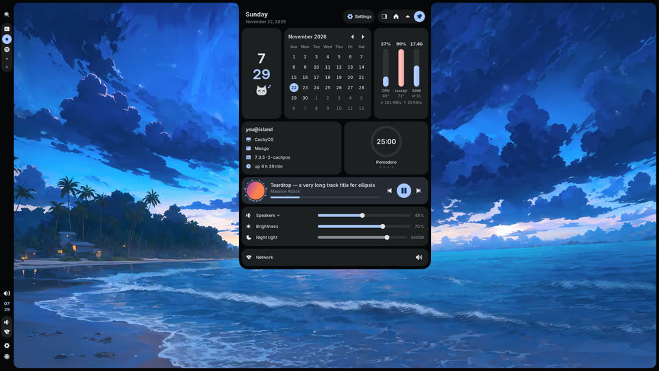
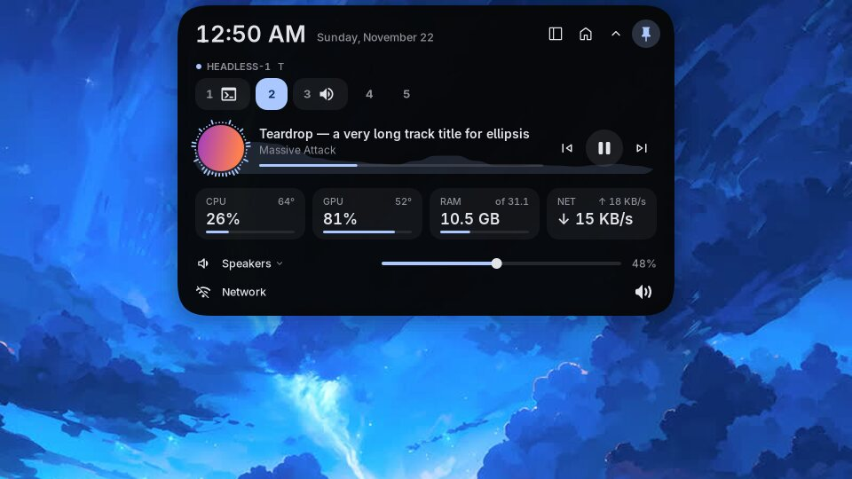
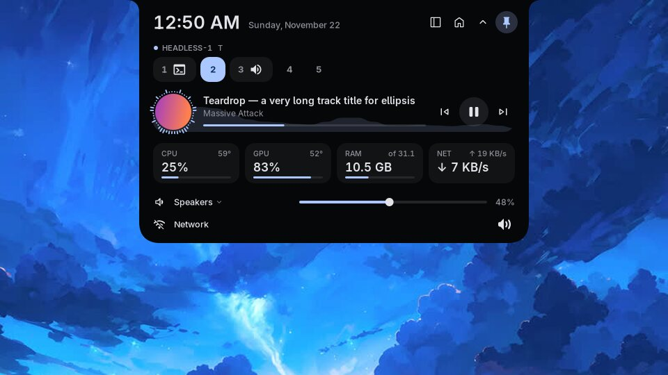
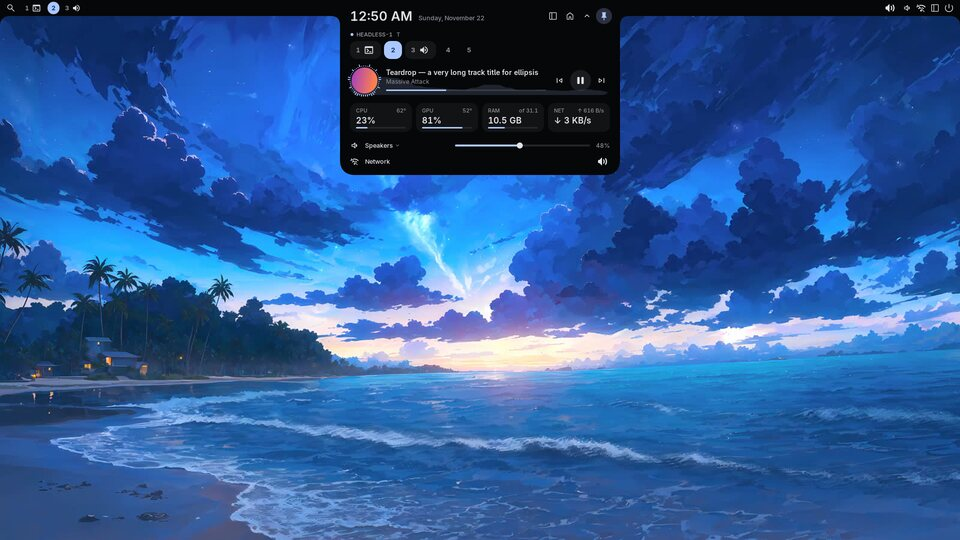
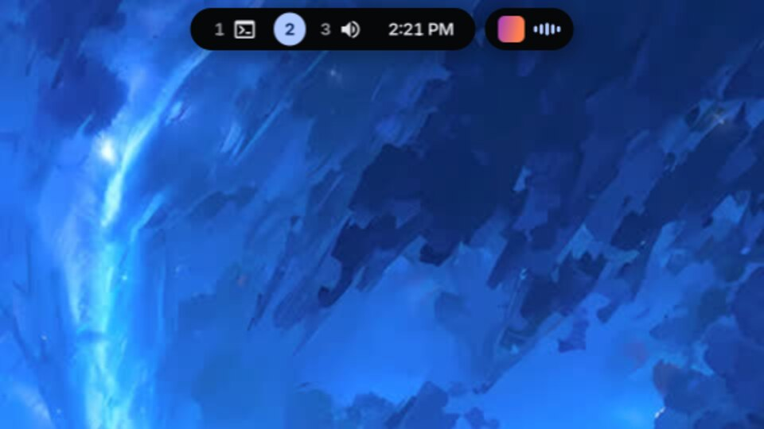
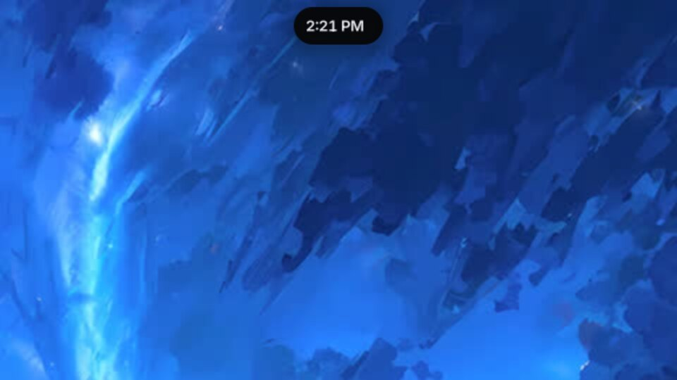
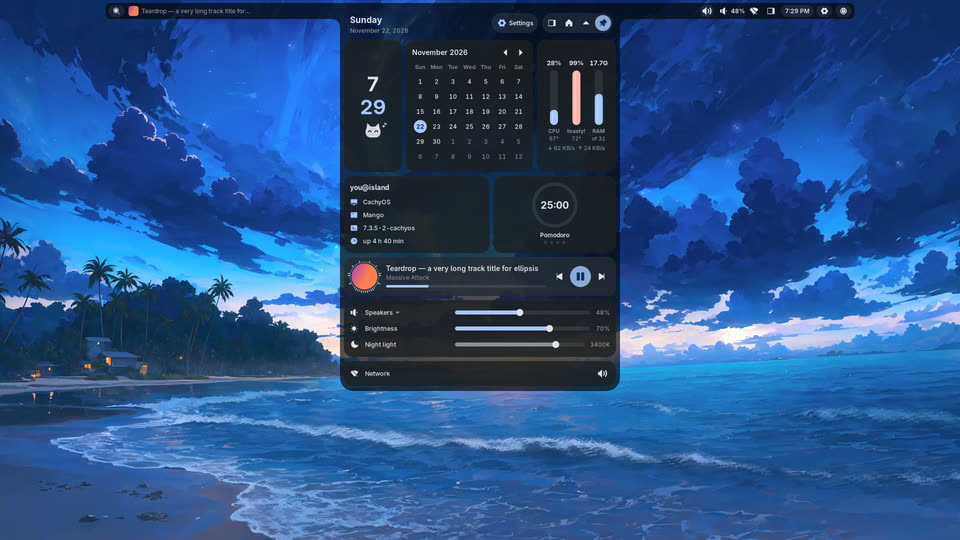

# Rust Dynamic Island for Mango

A minimal, modular, all-in-one desktop tool for [MangoWC](https://mangowm.github.io),
written in Rust. One island replaces your bar, app launcher, notification daemon and
power menu, and adds a sidebar, calendar, music visualizers, clipboard search,
screenshots, Wi-Fi and Bluetooth. It comes in seven styles, from a floating pill to a
border round the whole screen. Use all of it, or only the parts you want.

**[Project page](https://nurexa.github.io/Rust-Dynamic-Island-for-Mango/)** ·
[Modding guide](MODDING.md)


## Styles

| | |
|---|---|
|  |  |
| **frame**: a border with a rail; the island, palette and sidebar grow out of it | **pill** (the default): floats, drags anywhere |
|  |  |
| **notch**: hangs from the top edge | **bar**: full width, swells down into the panel |
|  |  |
| **split**: music, timers and Claude bud off into a bubble | **minimal**: the time, and what needs you |
|  | |
| **glass**: a see-through floating bar in three groups, blurred by Mango | |

Switch live with `island style frame` (or plain `island style` for the next one), or set
`style = "frame"` in the config; whichever you did last wins. Only frame, bar and glass take
space from your windows: 40 px on the left and 8 px on the other edges for frame, 32 px
at the top for bar, 38 px for glass. The frame style is inspired by
[Caelestia](https://github.com/caelestia-dots/shell); none of its code is used.

## Settings

There's no need to open the config file. **Settings** is a button at the top of the panel,
the last tab in search, a gear on the sidebar, the frame's rail and the bars, and
`island settings`. It has a control for every key in `config.toml`: style, colors, icons,
fonts, what's on the pill, panel and sidebar and in what order, add-ons, timings,
commands, keys, and your own modules and search tabs. Type to find any of them.

A change applies live and is written to `config.toml`: comments and layout stay, a value
the island wouldn't accept isn't saved, a symlinked file is written through, and the
version before is kept as `config.toml.bak`.

A few also work from a terminal:

```sh
island set scale 1.25      # 0.75 to 2
island set blur on         # on, off, or auto (glass only)
island set opacity 0.8     # or auto
island set media off       # any add-on by name
island preset light        # the basics; full brings the rest back
```

Those are saved beside the config instead, and hold until that setting's line changes or you
change it in Settings. A part switched off starts no watcher of its own the next time the
island starts.

### Colors and depth

`palette` points at a small file of six colors. The island works out its layers from them
(wells, background, cards, the leading card, controls) as steps of contrast rather than
fixed tints, so they stay apart and readable on black, white, pastel or neon alike.

### Blur

The island draws itself see-through; Mango does the blurring. That needs `blur=1` and
`blur_layer=1` in its config, which `./install.sh --blur` writes for you. `blur_layer` is
for all layers, so other see-through ones (launchers, notification daemons) blur too
unless they have a `no_blur` rule. Without it glass is just see-through, and `island
doctor` says so.

## What's in it

| Part | Replaces | How you reach it |
|---|---|---|
| Bar | Waybar | Hover the pill |
| Sidebar | eww and swaync control centres | `island sidebar`, `Super+Alt+S`, or the frame's right border |
| Calendar | gsimplecal, calendar scripts | The sidebar, with events from local .ics files |
| Music visualizers | cava widgets | The pill, panel and sidebar, while music plays |
| App search | rofi `drun` | `island open apps` |
| Run prompt | rofi `run` | `island open run` |
| Window switcher | rofi `window` | `island open windows` |
| Notifications | dunst, mako | Appear in the pill, with history in the panel |
| Clipboard | rofi and cliphist scripts | `island open clipboard` |
| Screenshots | grim and slurp scripts | `island open screenshot`, `island shot region` |
| Wi-Fi | rofi-wifi scripts | `island open wifi` |
| Bluetooth | blueman, rofi-bluetooth | `island open bluetooth` |
| Wallpaper picker | rofi thumbnail scripts | `island open wallpaper` |
| Power menu | wlogout | `island open power` |
| Script menus | `rofi -dmenu` | `island dmenu` |
| Calculator and units | qalculate, rofi-calc | Type `84/2` or `10 km to mi` in app search |
| File search | fsearch, rofi file scripts | `island open files` |
| Web search | browser start pages | The last row of app search |
| Pomodoro | timer apps | The panel, or `island timer` |
| Night light | wlsunset, gammastep | The panel, or `island nightlight` |
| Per-app volume | pavucontrol | Click the output's name in the panel |
| Monitor brightness | ddcutil scripts | A slider per monitor in the panel |
| Battery | Waybar's battery module | The pill, on laptops |
| Mic and camera dots | | The pill, while an app uses them |
| Claude Code status | | The pill, with permission cards |

**Every part is optional.** Switch it off in Settings or the config, or install with
`--light`. Tools can also be left out of the binary with a Cargo feature. A tool costs
nothing until you open it: its list is built on demand and dropped when it closes.

The island doesn't replace your lock screen, idle daemon or polkit agent. Those guard
your session, and they should stay small, separate programs.

## Benchmarks

The island against Waybar 0.16.0 (stock config), measured 2026-11-22 in one private headless
Mango with the same windows and apps. Each number is the median of 5 runs, with the order
rotated so none gets the warm cache, and child processes count. Lower is better, and the
better of those two is bold. [mangobar](https://github.com/mangowm/mangobar) 0.2.2 was last
measured on Nov 2 and is shown for reference, not ranked.

| | Waybar | Island | mangobar, on Nov 2 |
|---|---|---|---|
| Real memory (PSS) | 28.0 MB | **11.8 MB** | 18.6 MB |
| Resident memory (RSS) | 58.8 MB | **33.2 MB** | 40.6 MB |
| CPU per workspace switch | n/a | 1.0 ms | 0.5 ms |
| Bar startup | 95 ms | **46 ms** | 50 ms |
| Idle wakeups per second | **3.4** | 6.3 | 12.0 |
| Idle CPU, across all runs | 0.03–0.1% | **0%** | 0–0.07% |
| Binary size | 3.8 MB | 3.8 MB | 0.3 MB |

Waybar's stock config has no module for Mango's workspaces, so it redraws nothing on a switch
and that cell is n/a. The island's switch cost is counted in 10 ms clock ticks over 40
switches, so 0.25 ms is the resolution.

Absolute numbers move with what else is running, so compare within a session: startup,
wakeups and switch cost varied widely between these runs, memory hardly at all. The previous
build, without glass, settings and scale, read 12.5 MB PSS and 34.9 MB RSS in the same
rotation, so this one is lighter by 0.7 MB and 1.7 MB.

Each style at rest, and the light setup (median of 3):

| | pill | frame | notch | bar | glass | split | minimal | light setup |
|---|---|---|---|---|---|---|---|---|
| PSS, MB | 11.8 | 12.4 | 11.8 | 12.1 | 12.6 | 11.9 | 10.6 | 11.5 |
| CPU per switch, ms | 1.75 | 0.5 | 0.75 | 1.25 | 1.25 | 1.0 | 0.75 | 0.75 |

Blur is Mango's work, on the GPU, and isn't counted in the island's numbers.

While music plays, the pill's bars cost 0.9% of one core, the panel's wave and ring 2.7%,
and the sidebar's 3.0% (fed synthetic audio). Paused, they cost 0.01% and
capture stops. The sidebar takes about 4 MB while it's open and the palette about 3.5 MB;
the launcher is on screen 14 ms after its key. A busy desktop moves these numbers,
so rerun it on yours.

Run `bench/run.py` to reproduce this (`BASELINE=path/to/older/island` adds an older build);
raw results are in `bench/results.json`.

## Install

From a terminal inside your Mango session:

```sh
git clone https://github.com/nurexa/Rust-Dynamic-Island-for-Mango
cd Rust-Dynamic-Island-for-Mango
./install.sh             # everything
./install.sh --manual    # the same, but asks about each part and each key first
./install.sh --bar-only  # only replace the bar; launchers, dunst and your binds stay
./install.sh --style=frame   # start in a style
./install.sh --light     # the basics; everything else stays one switch away
./install.sh --style=glass --blur   # glass, with Mango blurring behind it
./install.sh --undo      # put it all back
```

Or from a package, then run its installer the same way:

```sh
paru -S rust-dynamic-island-git            # Arch (AUR); rust-dynamic-island for releases
/usr/share/island/install.sh

nix profile install github:nurexa/Rust-Dynamic-Island   # Nix
~/.nix-profile/share/island/install.sh
```

It prints each step as it goes and sends a notification when it's done.

The installer keeps your key bindings on the same keys and only changes what they run,
so a key that opened rofi, wofi, fuzzel, tofi, anyrun or walker now opens the island.
Each original line stays in your config as a comment, and `--undo` restores the file
exactly. The island's own keys and window rule go in `mango/island.conf`, which your
config sources from one marked block. Both `config.conf` and `config.toml` work, and so
does a config that's a symlink into your dotfiles; `MANGO_CONFIG=/path` points it anywhere
else.

If you already use one of the island's keys (Mango's own default config takes `SUPER+i`),
yours wins: the installer leaves that island key out and tells you which line has it.
`--manual` asks for another key instead. Waybar, dunst, mako or swaync started from
`exec_once` stop starting with the session, and `--undo` starts them again. It also masks
dunst's service, because D-Bus would otherwise restart it on the next notification.

A plain install keeps every extra this machine can run (the table above) and adds Claude
Code's hooks if it's installed. `--manual` asks about the style, each extra, a folder of
calendar files, a night light schedule and the web search engine, and writes only what
you chose to `~/.config/island/config.toml`.
Run `island doctor` afterwards to see what works here.

It checks the result with Mango's own parser (`mango -p`). Warnings your config already
had don't block it, and if anything new goes wrong, or the island doesn't come up, it
rolls back on its own. Nothing is uninstalled, so your old tools stay available.

Builds need Rust, `cairo`, `pango` and `libxkbcommon`. At runtime the island uses
`pactl` (and `parec` beside it, for visualizers), `wpctl`, `playerctl` (with
`playerctld`), `curl` and, for app glyphs, any Nerd Font. Its own icons are built in. Each tool lists what it needs in [MODDING.md](MODDING.md), and one whose
programs are missing simply doesn't appear.

## Using it

| Do this | To get this |
|---|---|
| Hover the pill | Open the panel; move away to close it |
| `Super+Space`, or any bind you've moved over | Open the palette |
| Click the pill background, or `Super+I` | Keep the panel open (pin) |
| Drag the pill | Move it anywhere on that monitor |
| Double-click the background, or `Super+Alt+I` | Send it home |
| Middle-click the background, or `Super+Shift+I` | Tuck it into a thin sliver |
| Scroll on the pill | Move through occupied workspaces |
| `Super+Alt+S`, or `island sidebar` | Open or close the sidebar |
| `island style` | Change its shape |
| `island settings`, or Settings in the panel, rail, bars and search | Change anything in the config, without opening it |

Dragging is for the floating styles (pill, split, minimal); frame, notch, bar and glass belong
to their edge. In frame, hover the top border for the panel, the middle of the right
border for the sidebar, and the palette rises from the bottom. The rail has search,
workspaces, the tray, the clock (click it for the sidebar), status and power.

The sidebar holds a player, the calendar, quick controls and every notification, and
scrolls when that's too much. Point `dir` under `[calendar]` at a folder of .ics files
(vdirsyncer keeps one) and days get dots, with what's next underneath. It reads them
when you look and never goes on the network.

Visualizers listen to what your speakers play, through `parec`, only while music plays
and one is on screen. Paused, tucked away, under fullscreen or switched off with
`visualizer = []`, nothing runs.

In the palette, type to search, use the arrows or `Ctrl+N`/`Ctrl+P` to move (every palette key is rebindable under `[keys]` in the config), and press
`Enter` to choose. `Tab` moves between tools, and `Esc` closes it. Reboot, shut down and
log out ask for a second `Enter`.

In pill, split, minimal and notch the island floats over your windows and never moves them. It stays under
fullscreen windows, apart from the palette and critical notifications. Keyboard focus
is taken only while the palette is open, and goes straight back afterwards.

Notifications appear in the pill and leave on their own. Hover one to hold it, click it
to open or dismiss, and right-click to dismiss. Critical ones stay until you deal with
them. `island dnd` turns on do not disturb, which keeps notifications in the panel's
history without showing them. Switching notifications off in Settings hands them to
another daemon at once, if one is running (the installer masks dunst; `--undo` brings it back).

Several from one app within a few seconds share one card that shows the newest and a
`+N` count. The history groups them by app: click an app's header to see all of them,
or its `×` to clear them. Apps that take inline replies (chat apps on KDE and GNOME do)
get a Reply button: type into the card and press `Enter` to send, or `Esc` to cancel.

App search answers sums and conversions (`2^10/3`, `sqrt(2)*pi`, `72 f in c`,
`3.5 GiB to MB`) in its top row, where `Enter` copies the answer, and ends with a web
search for what you typed (`web_search` picks the engine). `island open files` searches
files as you type, with plocate's index or fd.

The pomodoro runs from its panel row or `island timer` (`start`, `toggle`, `stop`,
`skip`, or minutes for a plain countdown). While it runs the pill shows the minutes left,
and a note says when each phase ends; lengths are under `[pomodoro]`.

The night light warms and dims the screen itself, with no wlsunset or gammastep: click
its icon in the panel, drag its slider for warmth, run `island nightlight`, or give it a
`schedule` under `[nightlight]`.

Click the output's name in the panel for every output and microphone to switch to, and a
slider and mute for each app that's playing. The pill shows an orange dot while an app
records a microphone and a green one while an app has the camera; hover to see which.
On a laptop the pill shows the battery, plugging in flashes "Charging", and notes warn at
20% and 10%. With ddcutil, each desktop monitor gets its own brightness slider.

With Claude Code installed, the pill shows what each session is doing: working, needs
you, or done. A permission prompt in a terminal you're not looking at becomes a card
with Allow, Always allow and Deny, and a session that finishes while you're elsewhere
leaves a note that jumps back to its terminal. `island claude-setup` adds the hooks
(the installer does this for you) and `island claude-setup --undo` takes them out.

`island doctor` checks what works on this machine and says how to fix what doesn't.

Panel controls:

| Control | Left | Right | Middle | Scroll |
|---|---|---|---|---|
| Workspace chip | Switch to it | Send the focused window there | | |
| App icon | Focus that window | Send the focused window to that workspace | | |
| Volume slider | Set volume, or drag | Open the mixer | | ±5% |
| Speaker icon | Mute | Open the mixer | | |
| Network | Open the Wi-Fi tool | Run `wifi_alt` | | |
| Bluetooth | Open the Bluetooth tool | | | |
| Bluetooth switch | Turn the adapter on or off | | | |
| Wallpaper button | Open the picker | Run `wallpaper_next` | Run `wallpaper_toggle` | |
| Tray icon | Activate | App's menu | Secondary activate | |
| Album art on the pill | Play or pause | Next | Previous | |

## Wallpapers

`wall/wall` is a small animated-wallpaper engine (needs `gslapper`, `ffmpeg`, `awww`) that
the installer puts in `~/.local/bin`. Set `wallpaper_opt = "wall opt"` and the wallpaper picker gains **Settings ›**: fit (fill,
or the whole picture with black bars for non-16:9 videos), speed, frame rate and quality,
for every wallpaper or just the one showing.

Videos play from a cached copy encoded once at your monitor's exact size and frame rate, so
nothing is rescaled or retimed while playing. Changing a setting re-encodes once (with a
crossfade when it's ready) and is remembered. Open the picker with `island open wallpaper`; Settings expands into Fit, Speed, FPS,
Quality and Apply to, and Esc steps back out. `wall opt` does the same from a terminal.
They stay out of the main panel by default; add `"wallpaper"` to `panel` if you want them there.

## Make it yours

Everything is in `~/.config/island/config.toml`, and `island reload` applies changes
without a restart. [`examples/config.toml`](examples/config.toml) lists every option.

```toml
tools = ["apps", "clipboard", "projects"]   # the palette's tabs
notifications = false                       # keep your own daemon
style = "frame"                             # or pill, notch, bar, glass, split, minimal
icon_style = "glyph"                        # two-tone glyphs, or "color" for app icons

[[tool]]                                    # a tool made of two shell commands
name = "projects"
list = "ls ~/Projects"
run = "kitty -d ~/Projects/{}"

[[custom]]                                  # a pill or panel module from one command
name = "weather"
exec = "curl -s 'wttr.in/?format=%t'"
interval = 600
```

For a smaller binary, build only what you need:

```sh
cargo build --release --no-default-features --features "apps,clipboard,notifications"
```

Scripts written for rofi work by swapping the command:

```sh
choice=$(printf 'Small\nLarge\n' | island dmenu -p "Size")
```

Modules and tools are one file each, and compositor support sits behind a six-method
trait. [MODDING.md](MODDING.md) covers all of it, with worked examples.

## How it works

| Path | Job |
|---|---|
| `src/modules/` | One file per pill, panel, rail and sidebar part, and the lists that order them |
| `src/tools/` | One file per palette tool, and the list that registers them |
| `src/wm/` | Compositor backends, and the trait they implement |
| `src/palette.rs` | Search, ranking and keys for every tool |
| `src/notify.rs` | The notification queue and history |
| `src/island.rs` | One island per output: states, springs, frames, input |
| `src/style.rs` | The styles, and the outlines they're made of |
| `src/edges.rs` | The frame's and bar's strips, and the space they reserve |
| `src/sidebar.rs` | The sidebar's surface, from opening to closed |
| `src/canvas.rs` | The buffers every surface draws through |
| `src/viz.rs` | Capture, the spectrum, and drawing the visualizers |
| `src/calendar.rs` | Dates and .ics files, recurrences included |
| `src/symbols.rs` | The island's own icons, as paths |
| `src/pen.rs` | The drawing kit modules share, and the glyph table |
| `src/bus.rs` | D-Bus: media, tray and the notification service |
| `src/net.rs` `src/audio.rs` `src/sys.rs` | Network, audio devices and apps, hardware stats |
| `src/bluetooth.rs` `src/power.rs` `src/ddc.rs` | BlueZ, UPower and ddcutil, each by event or on demand |
| `src/nightlight.rs` `src/privacy.rs` `src/timer.rs` | Gamma ramps, camera watch, pomodoro |
| `src/claude.rs` `src/doctor.rs` | Claude Code hooks; `island doctor` |
| `src/theme.rs` `src/icons.rs` `src/settings.rs` | Palette, icons, config, saved state |

Why it doesn't use the obvious approach in a few places:

- **The surface never resizes.** A layer surface resize takes a round trip per frame,
  so one fixed transparent surface holds the morph, and the input region follows the
  visible shape so clicks pass through the rest.
- **There's no screen-sized surface.** The frame is four thin strips, under a megabyte at
  1080p where one fullscreen buffer pair is 16. Four invisible pixels hold the space,
  because a strip with corners on it is bigger than what it reserves.
- **Joins are one shape.** An attached island draws the piece of band it hangs from, in
  the same opaque color, so there's no seam to line up.
- **Visualizers repaint a rectangle.** They're an overlay on cached content, so a frame
  costs their own few pixels and nothing is laid out again.
- **Rendering is CPU only.** Cairo draws into shared memory with no GL context. Content
  renders once into cached surfaces, so animation frames just composite those.
- **Nothing runs while idle.** There are no animation loops, and Mango, audio, media,
  network and theme all arrive as events. Tools load on demand, and stats are read only
  while a panel is open.
- **Drags use relative pointer motion.** Surface coordinates race the island's own
  position updates and jitter.
- **NVML lives in a child process.** It uses tens of MB, and each init and shutdown
  leaks a file descriptor inside the driver library. The `--gpu-sampler` child runs only
  while a panel is open.
- **Untrusted text stays text.** Notification markup is flattened instead of rendered,
  and clipboard contents and filenames never reach a shell.

## Tests

```sh
cargo test                 # unit tests
tests/headless/all.sh      # end-to-end: read the output for FAIL
```

The end-to-end suite runs a private headless Mango and a private session bus, drives a
virtual pointer and keyboard, and checks results through Mango's IPC and screenshots.
Audio, `systemctl` and `nmcli` are shimmed and the system bus is a private one with a fake
BlueZ, so it can't change your volume, network or Bluetooth, or reboot your machine.

Never start a test Mango with `DBUS_SESSION_BUS_ADDRESS` set: on exit it stops
`graphical-session.target`, which takes the live desktop down. `start.sh` unsets it.

## Limits

- Workspaces and the window switcher need a compositor backend: Mango and Hyprland have
  one. On other layer-shell compositors everything else should work, but that isn't
  tested; see [MODDING.md](MODDING.md). The installer only edits Mango's config so far.
- Claude Code permission cards only appear for a terminal you're not looking at. Answering
  in the terminal instead works too, and the card goes away.
- A palette opened with a click outside it stays open: close it with `Esc`.
- Normal notifications stay under fullscreen windows, so one that times out during a game
  goes straight to history.
- Fractional scales render at the next whole scale and the compositor scales down.
- Clicking a chip on another monitor moves the cursor there, because of Mango's
  `warpcursor`, which is on by default.
- GPU stats are NVIDIA only. Other GPUs simply have no GPU tile.
- Each pill stays on its own monitor; it can't be dragged across to another.
- One sidebar is open at a time, on the monitor you opened it from.
- The calendar doesn't do hourly recurrences, `RDATE` or `BYWEEKNO`, and reads Windows
  time zone names as local time.
- Long tray menus are cut off at the panel's maximum height. They don't scroll.
- Bluetooth pairing has no agent, so a device that asks for a PIN or a passkey confirmation
  won't pair from the island; pair it once with `bluetoothctl`, then connect from here.

## Star history

[](https://star-history.com/#nurexa/Rust-Dynamic-Island-for-Mango&Date)

## License

GPL-3.0. See [LICENSE](LICENSE). The built-in icons are
[Material Symbols](https://github.com/google/material-design-icons) Rounded by Google,
under [Apache-2.0](LICENSES/Apache-2.0.txt).
