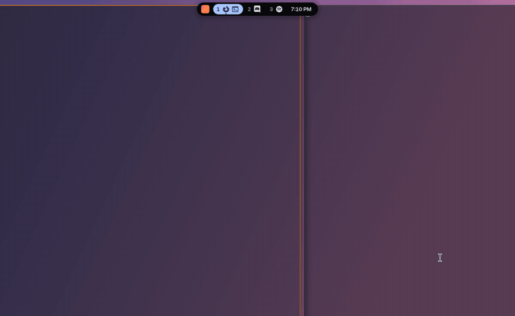

# Rust Dynamic Island for Mango

A minimal, modular, all-in-one desktop tool for [MangoWC](https://mangowm.github.io),
written in Rust. One pill replaces your bar, app launcher, notification daemon and
power menu, and adds clipboard search, screenshots and Wi-Fi. Use all of it, or only
the parts you want.

**[Project page](https://nurexa.github.io/Rust-Dynamic-Island-for-Mango/)** ·
[Modding guide](MODDING.md)



## What's in it

| Part | Replaces | How you reach it |
|---|---|---|
| Bar | Waybar | Hover the pill |
| App search | rofi `drun` | `island open apps` |
| Run prompt | rofi `run` | `island open run` |
| Window switcher | rofi `window` | `island open windows` |
| Notifications | dunst, mako | Appear in the pill, with history in the panel |
| Clipboard | rofi and cliphist scripts | `island open clipboard` |
| Screenshots | grim and slurp scripts | `island open screenshot`, `island shot region` |
| Wi-Fi | rofi-wifi scripts | `island open wifi` |
| Wallpaper picker | rofi thumbnail scripts | `island open wallpaper` |
| Power menu | wlogout | `island open power` |
| Script menus | `rofi -dmenu` | `island dmenu` |

**Every part is optional.** Leave it out of a list in the config, or leave it out of the
binary with a Cargo feature. A tool costs nothing until you open it: its list is built
on demand and dropped when it closes.

The island doesn't replace your lock screen, idle daemon or polkit agent. Those guard
your session, and they should stay small, separate programs.

## Benchmarks

Measured with a daily-driver Waybar config on the same compositor, with the same
windows and apps. Each number is the median of 3 runs, and child processes count.

| | Waybar + dunst | Island |
|---|---|---|
| Real memory (PSS) | 47 MB | **13.6 MB** |
| Resident memory (RSS) | 90.7 MB | **35.8 MB** |
| CPU per workspace switch | 27.5 ms | **1.25 ms** |
| Bar startup | 106 ms | **31 ms** |
| Launcher open, against rofi | 41 ms | **8 ms** |
| Idle CPU, across all runs | 0–2.2% | 0–0.1% |
| Binary size, Waybar alone | **2.5 MB** | 3.3 MB |

Memory counts Waybar and dunst together, because the island does both jobs, and includes
the island's `pactl` listener. Idle is effectively a tie, since both sit near zero and
Waybar moves with audio server activity. Waybar's switch cost includes the helper
commands its custom workspace modules run, but not the separate script that feeds
them. Launcher times stop when rofi's window maps and when the island has raised
itself and taken the keyboard, so treat that gap as indicative. Opening the palette
adds about 3 MB while it's open.

Run `bench/run.py` to reproduce this; raw results are in `bench/results.json`.

## Install

From a terminal inside your Mango session:

```sh
git clone https://github.com/nurexa/Rust-Dynamic-Island-for-Mango
cd Rust-Dynamic-Island-for-Mango
./install.sh             # everything
./install.sh --bar-only  # only replace Waybar; rofi, dunst and your binds stay
./install.sh --undo      # put it all back
```

The installer keeps your key bindings on the same keys and only changes what they run,
so a key that opened rofi now opens the island. Each original line stays in
`config.conf` as a comment, and `--undo` restores the file exactly. It also stops dunst
and masks its service, because D-Bus would otherwise restart it on the next
notification.

It checks the new config with Mango's parser and rolls back on its own if the island
doesn't come up. Nothing is uninstalled, so your old tools stay available.

Builds need Rust, `cairo`, `pango` and `libxkbcommon`. At runtime the island uses
`pactl`, `wpctl`, `playerctl` (with `playerctld`), `curl`, `adwaita-icon-theme` and any
Nerd Font. Each tool lists what it needs in [MODDING.md](MODDING.md), and one whose
programs are missing simply doesn't appear.

## Using it

| Do this | To get this |
|---|---|
| Hover the pill | Open the panel; move away to close it |
| `Super+Space`, or any bind you've moved over | Open the palette |
| Click the pill background, or `Super+I` | Keep the panel open (pin) |
| Drag the pill | Move it anywhere on that monitor |
| Double-click the background, or `Super+Alt+I` | Send it home |
| Middle-click the background, or `Super+Shift+I` | Tuck it into a thin sliver |
| Scroll on the pill | Move through occupied workspaces |

In the palette, type to search, use the arrows or `Ctrl+N`/`Ctrl+P` to move, and press
`Enter` to choose. `Tab` moves between tools, and `Esc` closes it. Reboot, shut down and
log out ask for a second `Enter`.

The island always floats over your windows and never moves them. It stays under
fullscreen windows, apart from the palette and critical notifications. Keyboard focus
is taken only while the palette is open, and goes straight back afterwards.

Notifications appear in the pill and leave on their own. Hover one to hold it, click it
to open or dismiss, and right-click to dismiss. Critical ones stay until you deal with
them. `island dnd` turns on do not disturb, which keeps notifications in the panel's
history without showing them.

Panel controls:

| Control | Left | Right | Middle | Scroll |
|---|---|---|---|---|
| Workspace chip | Switch to it | Send the focused window there | | |
| App icon | Focus that window | Send the focused window to that workspace | | |
| Volume slider | Set volume, or drag | Open the mixer | | ±5% |
| Speaker icon | Mute | Open the mixer | | |
| Network | Open the Wi-Fi tool | Run `wifi_alt` | | |
| Wallpaper button | Open the picker | Run `wallpaper_next` | Run `wallpaper_toggle` | |
| Tray icon | Activate | App's menu | Secondary activate | |
| Album art on the pill | Play or pause | Next | Previous | |

## Make it yours

Everything is in `~/.config/island/config.toml`, and `island reload` applies changes
without a restart. [`examples/config.toml`](examples/config.toml) lists every option.

```toml
tools = ["apps", "clipboard", "projects"]   # the palette's tabs
notifications = false                       # keep your own daemon
icon_style = "glyph"                        # two-tone glyphs, or "color" for app icons

[[tool]]                                    # a tool made of two shell commands
name = "projects"
list = "ls ~/Projects"
run = "kitty -d ~/Projects/{}"

[[custom]]                                  # a pill or panel module from one command
name = "weather"
exec = "curl -s 'wttr.in/?format=%t'"
interval = 600
```

For a smaller binary, build only what you need:

```sh
cargo build --release --no-default-features --features "apps,clipboard,notifications"
```

Scripts written for rofi work by swapping the command:

```sh
choice=$(printf 'Small\nLarge\n' | island dmenu -p "Size")
```

Modules and tools are one file each, and compositor support sits behind a six-method
trait. [MODDING.md](MODDING.md) covers all of it, with worked examples.

## How it works

| Path | Job |
|---|---|
| `src/modules/` | One file per pill and panel module, and the list that orders them |
| `src/tools/` | One file per palette tool, and the list that registers them |
| `src/wm/` | Compositor backends, and the trait they implement |
| `src/palette.rs` | Search, ranking and keys for every tool |
| `src/notify.rs` | The notification queue and history |
| `src/island.rs` | One island per output: states, springs, frames, input |
| `src/pen.rs` | The drawing kit modules share, and the glyph table |
| `src/bus.rs` | D-Bus: media, tray and the notification service |
| `src/net.rs` `src/audio.rs` `src/sys.rs` | Network, volume, hardware stats |
| `src/theme.rs` `src/icons.rs` `src/settings.rs` | Palette, icons, config, saved state |

Why it doesn't use the obvious approach in a few places:

- **The surface never resizes.** A layer surface resize takes a round trip per frame,
  so one fixed transparent surface holds the morph, and the input region follows the
  visible shape so clicks pass through the rest.
- **Rendering is CPU only.** Cairo draws into shared memory with no GL context. Content
  renders once into cached surfaces, so animation frames just composite those.
- **Nothing runs while idle.** There are no animation loops, and Mango, audio, media,
  network and theme all arrive as events. Tools load on demand, and stats are read only
  while a panel is open.
- **Drags use relative pointer motion.** Surface coordinates race the island's own
  position updates and jitter.
- **NVML lives in a child process.** It uses tens of MB, and each init and shutdown
  leaks a file descriptor inside the driver library. The `--gpu-sampler` child runs only
  while a panel is open.
- **Untrusted text stays text.** Notification markup is flattened instead of rendered,
  and clipboard contents and filenames never reach a shell.

## Tests

```sh
cargo test                 # unit tests
tests/headless/all.sh      # end-to-end
```

The end-to-end suite runs a private headless Mango and a private session bus, drives a
virtual pointer and keyboard, and checks results through Mango's IPC and screenshots.
Audio, `systemctl` and `nmcli` are shimmed, so it can't change your volume or network or
reboot your machine.

Never start a test Mango with `DBUS_SESSION_BUS_ADDRESS` set: on exit it stops
`graphical-session.target`, which takes the live desktop down. `start.sh` unsets it.

## Limits

- Workspaces and the window switcher need a compositor backend, and Mango's is the only
  one so far. On other layer-shell compositors everything else should work, but that
  isn't tested yet; see [MODDING.md](MODDING.md). The installer is Mango-only too.
- A palette opened with a click outside it stays open: close it with `Esc`.
- Normal notifications stay under fullscreen windows, so one that times out during a game
  goes straight to history.
- Fractional scales render at the next whole scale and the compositor scales down.
- Clicking a chip on another monitor moves the cursor there, because of Mango's
  `warpcursor`, which is on by default.
- GPU stats are NVIDIA only. Other GPUs simply have no GPU tile.
- Each pill stays on its own monitor; it can't be dragged across to another.
- Long tray menus are cut off at the panel's maximum height. They don't scroll.

## Star history

[](https://star-history.com/#nurexa/Rust-Dynamic-Island-for-Mango&Date)

## License

GPL-3.0. See [LICENSE](LICENSE).
